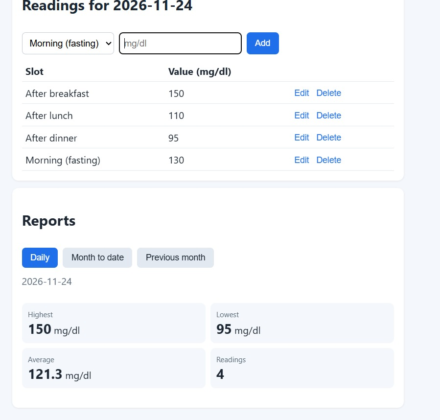
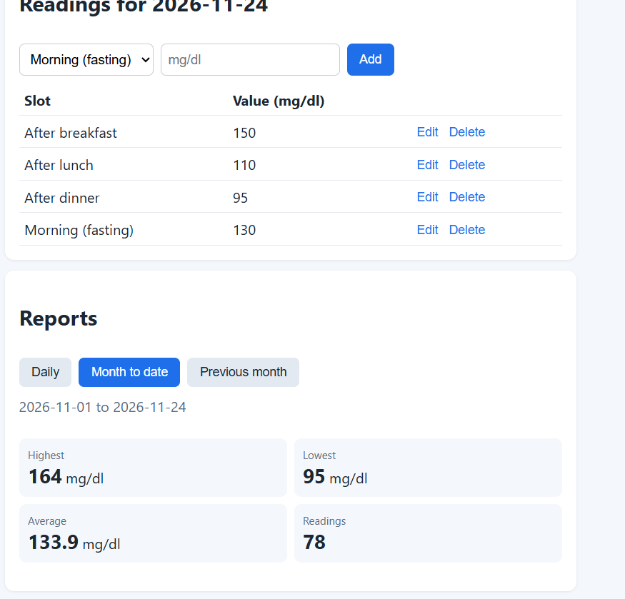
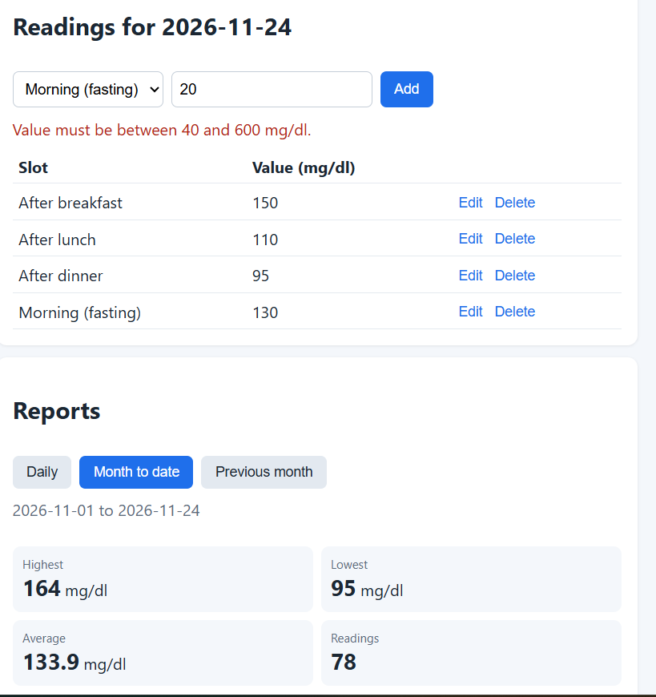

# Sweety - Blood Glucose Tracker

A small full-stack app where a diabetes patient records up to 4 blood glucose readings per day
and views daily, month-to-date and previous-month reports.

**Stack:** React (Vite) frontend, Node.js + Express API, PostgreSQL.

## What it does

- Sign up and log in (passwords hashed with bcrypt, JWT login token). Each user sees only their own readings.
- Add, view, edit and delete readings: date, one of 4 slots (Morning (fasting), After breakfast, After lunch, After dinner) and a value in mg/dl.
- Validation with clear messages: value required, whole number 40-600, one reading per slot per day, max 4 readings per day, no future dates.
- Reports for a chosen date: Daily (that date, also listed per slot), Month to date (1st of the month to the date), Previous month (the whole month before). Each shows highest, lowest, average (1 decimal) and number of readings, with an empty-state message.

## Requirements

Node.js 20 or newer, npm, PostgreSQL 15 or newer, git.

## Install and run

1. Create the database (the name is up to you, `sweety` is the default):

   ```
   createdb -U postgres sweety
   ```

2. Server:

   ```
   cd server
   npm install
   copy .env.example .env      (macOS/Linux: cp .env.example .env)
   ```

   Open `.env` and set `DB_PASSWORD`. Run `npm run genenv` to put a random `JWT_SECRET` in it (or set your own). Then:

   ```
   npm run db:init     # creates the tables
   npm run seed        # optional: demo user demo@example.com / demo1234 with sample readings
   npm start           # API on http://localhost:4000
   ```

3. Client (second terminal):

   ```
   cd client
   npm install
   npm run dev         # http://localhost:5173 (proxies /api to the server)
   ```

## Tests

```
cd server
npm test
```

Unit tests cover the validation rules and report date ranges. API tests use a separate database
called `<DB_NAME>_test` (for example `sweety_test`), created automatically with the same
credentials from `.env`, so your app data is never touched. They check signup/login, hashed
passwords, validation messages, duplicate and 4-per-day limits, per-user data isolation and
report numbers.

## API

| Method | Path | Notes |
| --- | --- | --- |
| POST | /api/auth/signup, /api/auth/login | body: name, email, password |
| GET | /api/readings?date=YYYY-MM-DD | own readings |
| POST | /api/readings | body: date, slot, value |
| PUT / DELETE | /api/readings/:id | own readings only |
| GET | /api/reports/daily, month-to-date, monthly?date=YYYY-MM-DD | needs login (Bearer token) |

Slots: `morning`, `after_breakfast`, `after_lunch`, `after_dinner`.

## Screenshots

Taken from the running app (demo user).





## Notes

Assumptions:

- "Previous month" means the whole calendar month before the selected date's month.
- "Today" and the future-date check use the server's local date.
- Value must be a whole number; decimals are rejected with the same 40-600 message.
- With one reading per slot and 4 slots, the "max 4 per day" rule is a second safety check on the same limit.
- Password minimum is 6 characters. I used `bcryptjs` (bcrypt algorithm in plain JavaScript) so installation needs no native compiler on Windows.
- The login token is kept in the browser's localStorage for simplicity.

How this was built: AI assistance was used extensively to build this project. It was run and tested locally with PostgreSQL.

With more time I would:

- add pagination on `GET /readings`, a line chart of the month, Docker compose for PostgreSQL and frontend tests with React Testing Library;
- keep the login token in an httpOnly cookie and add rate limiting on login;
- add database migrations instead of a single `schema.sql`.
